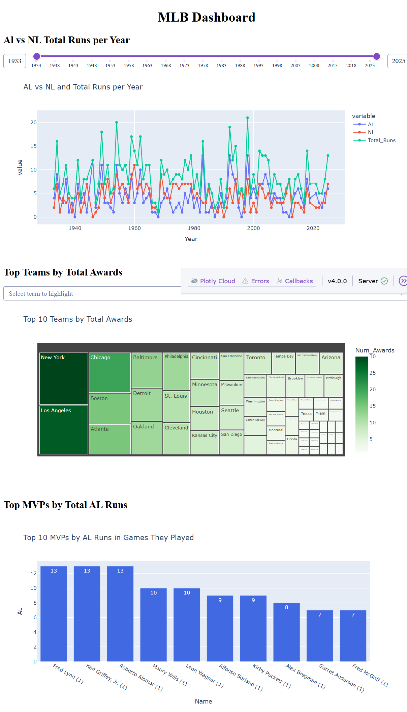

# MLB Data Project

## Overview

This project collects, cleans, stores, queries, and visualizes Major League Baseball (MLB) historical data using Python and SQLite.

The workflow includes web scraping, data import and cleaning, SQL queries, and interactive dashboards built with Dash and Plotly Express

## Live Demo

https://mlb-history-project.onrender.com/

## Dashboard Screenshot 



## Project Structure

- `scraper.py` - Scrapes MLB data from web sources
- `import_db.py` - Imports data into SQLite and performs cleaning and transformation
- `query_db.py` - Command-line program for querying the database (including JOIN queries)
- `dashboard.py` - Interactive dashboards using Dash and Plotly Express
- `mlb_history.db` - SQLite database

## Built with

- Python
- SQLite
- Pandas
- SQL
- Dash
- Plotly Express

## What This Project Demonstrates

- Web scraping 
- Data Cleaning and Preparation
- Database management
- SQL filtering and JOIN operations 
- Command-line interface
- Interactive data visualization

## Data Facts 
- Source: MLB historical data collected with a Python web scraper.
- Database: SQLite, 5 tables, 505 records in total.
- All-Star Games: 95 games, 1933-2025 (venue, date, AL/NL score).
- Awards: All-Star MVP (64 records), Cy Young (132), Rookie of the Year (160).
- Managers: 54 team managers with their years in charge.

## Sample query

All-Star Games joined with the game's MVP winner by year:

```sql
SELECT g.Year, g.Venue, g.AL, g.NL, m.Name AS MVP, m.Team
FROM all_star_game AS g
JOIN all_star_mvp_award AS m ON g.Year = m.Year
ORDER BY g.Year DESC
LIMIT 5;
```

| Year | Venue | AL | NL | MVP | Team |
| --- | --- | --- | --- | --- | --- |
| 2025 | Truist Park, Atlanta | 6 | 7 | Kyle Schwarber | Philadelphia Phillies |
| 2024 | Globe Life Field, Arlington | 5 | 3 | Jarren Duran | Boston Red Sox |
| 2023 | T-Mobile Park, Seattle | 2 | 3 | Elias Díaz | Colorado Rockies |
  
## How to Run

Run the scraper:
- `python scraper.py`

Import and clean data:
- `python import_db.py`

Run the query program:
- `python query_db.py`

Run the dashboard:
- `python dashboard.py`

## Author
Aiperi Amanturova(Lizard)
